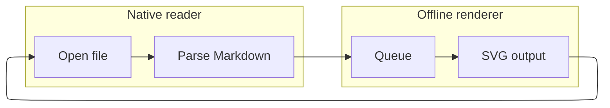

# Diagram engine upgrade regression checks

Explicit ELK compound layout and nested ZenUML calls exercise the upgraded offline engines.


## D092 — Mermaid / ELK compound graph



## D093 — ZenUML / nested calls and fragments

```zenuml
@Actor User
User -> Viewer.open() {
  Parser.parse()
  if (hasDiagrams) {
    loop (eachDiagram) {
      Worker.render() {
        Engine.layout()
      }
    }
  }
  return document
}
```
