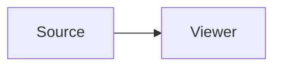
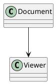

# Fenced languages with metadata

## Mermaid with a title



## PlantUML with attributes



## Standalone ZenUML with metadata

```ZenUML title="Sequence"
A->B: Hello
```

## Math with metadata

```math title="Square"
x^2
```

```latex {#sum}
a+b
```

```katex title="Integral"
\int_0^1 x^2 dx
```
